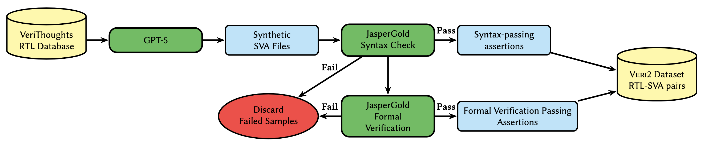

# Veri2: A Formally Verified RTL-SVA Dataset for Fine-Tuning Local Language Models

Veri2 is a dataset of 2,954 RTL-SVA pairs. The assertions were generated by GPT-5 (the GPT-5.4 model) from
RTL modules and kept only if they pass formal verification with Cadence JasperGold.
This repository contains the dataset, the code that built it, the fine-tuning and
inference notebooks, the outputs of every evaluated model, and the result files behind
each table of the paper.



## Repository layout

```text
veri2/               the dataset: three variants, each with train/validation/test splits
generation/          GPT-5 batch generation of SVA files (includes the full prompt)
scripts/             JasperGold syntax and formal checks used to filter the dataset and to score models
fine_tuning/         QLoRA fine-tuning notebook and inference notebook
inference_outputs/   outputs of the six evaluated models on the 578 test designs
evaluation/          tautology, redundancy and proof-core coverage checks; AssertionBench runner
results/             per-assertion and per-design results behind the tables below
```

## Dataset

Each line of a `.jsonl` file is one pair: `{"id": ..., "rtl": ..., "sva": ...}`.
The RTL comes from the verified subset of VeriThoughts (5,774 modules).

| Variant | Folder | Contents |
| --- | --- | --- |
| All | `veri2/all` | every generated RTL-SVA pair |
| Syntax | `veri2/syntax_pass` | pairs whose SVA file passes the JasperGold syntax check |
| Verified (Veri2) | `veri2/verified` | pairs that pass formal verification, with failing assertions removed |

The 5,774 designs were split into training (4,619), validation (577) and test (578)
sets before filtering, and the split is the same for all three variants. No validation
or test design appears in any training set.

|  | All | Syntax | Verified |
| --- | ---: | ---: | ---: |
| RTL-SVA pairs | 5,774 | 5,412 | 2,954 |
| Assertions | 45,440 | 42,116 | 18,494 |
| Assertions per pair (mean) | 7.9 | 7.8 | 6.3 |
| SVA lines of code (mean) | 37.8 | 37.6 | 29.8 |
| Module RTL lines of code (mean / median) | 23.4 / 18 | 23.3 / 18 | 20.6 / 17 |
| Sequential modules | 37.1% | 37.8% | 36.1% |
| Assertions with implication | 78.6% | 79.1% | 77.6% |
| Multi-cycle assertions | 36.6% | 37.2% | 25.8% |

These numbers are produced by `python3 evaluation/dataset_tier_stats.py`
(saved output: `results/dataset/tier_stats.txt`). The verdict of every assertion checked
during dataset construction is in `results/dataset/filtering_verdicts.csv`.

## How the dataset was built

1. **Generation.** `generation/generate_sva_batch.py` sends each RTL module to GPT-5
   through the batch API. The full system prompt is in that file; the same prompt is
   used for all fine-tuned models at inference time.
2. **Syntax check.** `scripts/check_all.sh syntax <dir>` runs `scripts/jasper_syntax_check.tcl`
   (`analyze -sv12`) on every generated file.
3. **Formal verification.** `scripts/check_all.sh verif <dir>` runs
   `scripts/jasper_verif_check.tcl`, which binds each checker to its module, infers the
   reset, and proves all assertions.

Settings used everywhere, for dataset filtering and for model evaluation: JasperGold
2021.03, SystemVerilog-2012 parsing, a proof time limit of 300 seconds per design, and
no declared clock (each assertion carries its own clocking event).

## Fine-tuning and inference

`fine_tuning/sva_qlora_finetune.ipynb` trains one QLoRA adapter per dataset variant on
Qwen2.5-Coder-7B-Instruct. The validation set selects the best checkpoint.

| Parameter | Value |
| --- | --- |
| LoRA rank / alpha | 64 / 128 |
| Epochs | 3 |
| Effective batch size | 16 |
| Learning rate | 2e-4, cosine schedule, warmup ratio 0.05 |
| Weight decay | 0.01 |
| Max sequence length | 8,192 |

`fine_tuning/sva_inference.ipynb` generates the outputs in `inference_outputs/` with a
sampling temperature of 0.1, top-p of 0.95 and at most 2,048 output tokens.

## Results

### End-to-end evaluation on the 578 test designs

Yield is the share of generated assertions that are formally proven.

| Model | Generated | Syntax | Compiled | Proven | Yield |
| --- | ---: | ---: | ---: | ---: | ---: |
| GPT-5 baseline | 4555 | 4233 | 2631 | 1884 | 41.4% |
| Base Qwen | 2950 | 986 | 660 | 383 | 13.0% |
| Adapter (All) | 4968 | 4146 | 2564 | 1709 | 34.4% |
| Adapter (Syntax) | 4137 | 3631 | 1858 | 1301 | 31.4% |
| Adapter (Verified) | 4170 | 3318 | 2844 | 2095 | **50.2%** |
| Adapter (VERT) | 3476 | 484 | 2595 | 1205 | 34.7% |

Outputs of the VERT adapter often declare properties without the `assert property`
statement that activates them. `scripts/fix_vert_sva.py` adds the missing statements
before elaboration without changing any property; the syntax count is for the unmodified
outputs. Model outputs are in `inference_outputs/<model>/<id>/`, and the verdict of every
assertion is in `results/test_set/assertion_verdicts.csv`.

### Quality of the proven assertions

A proven assertion can still be trivial, so every proven assertion goes through three
further checks:

- **Tautology:** the checker is elaborated alone, without the design. An assertion that
  is still proven holds for any design and is discarded.
- **Redundancy:** each remaining assertion is proven again with the others assumed. If
  the proof succeeds, the others already imply it and it is discarded.
- **Proof-core coverage:** the share of the design's coverage items that JasperGold
  needed to prove the assertions.

| Model | Proven | Tautological | Redundant | Retained | Designs with a proof | Proof-core coverage |
| --- | ---: | ---: | ---: | ---: | ---: | ---: |
| GPT-5 baseline | 1884 | 38 | 759 | 1076 (57.1%) | 310 | 88.8% |
| Base Qwen | 383 | 115 | 54 | 129 (33.7%) | 103 | 14.6% |
| Adapter (All) | 1709 | 42 | 695 | 945 (55.3%) | 299 | 85.7% |
| Adapter (Syntax) | 1301 | 14 | 398 | 887 (68.2%) | 267 | 84.3% |
| Adapter (Verified) | 2095 | 17 | 748 | **1326** (63.3%) | **398** | **91.8%** |
| Adapter (VERT) | 1205 | 377 | 230 | 595 (49.4%) | 349 | 61.8% |

Retained assertions pass the tautology and redundancy checks; the percentage is relative
to Proven, and a check that did not finish counts as not retained. Coverage is the mean
over the designs where it could be measured. Per-assertion outcomes are in
`results/test_set/assertion_quality.csv` and per-design coverage in
`results/test_set/coverage.csv`.

### External benchmark: AssertionBench

The base model and the three Veri2 adapters are run on 85 OpenCores designs from
AssertionBench, with the same prompt, sampling settings and proof script and an output
limit of 4,096 tokens. Of the 101 designs in the release, 7 cannot be compiled and 9 are
longer than the input limit.

| Model | Generated | Compiled | Proven | Yield | Retained | Proof-core coverage |
| --- | ---: | ---: | ---: | ---: | ---: | ---: |
| Base Qwen | 930 | 128 | 74 | 8.0% | 3.1% | 0.0% |
| Adapter (All) | 1476 | 412 | 207 | 14.0% | 11.0% | 72.6% |
| Adapter (Syntax) | 1357 | 406 | 198 | 14.6% | 9.1% | 61.2% |
| Adapter (Verified) | 1260 | 301 | 148 | 11.7% | 9.4% | **85.4%** |

Yield and Retained are shares of the generated assertions. Files are in
`results/assertionbench/`: `proof_results.csv`, `quality.csv`, `coverage.csv`, the list of
designs in `designs.csv`, and the model outputs in `outputs/`. The AssertionBench RTL is
not redistributed here; `SOURCE.txt` gives the upstream repository and revision.

## Reproducing the evaluation

All formal steps need a JasperGold license. From the repository root:

```sh
# 1. Syntax and formal checks for one model's outputs
./scripts/check_all.sh syntax inference_outputs/adapter_verified
./scripts/check_all.sh verif  inference_outputs/adapter_verified

# 2. Per-assertion verdicts from the saved logs
python3 evaluation/collect_verdicts.py --out results/test_set/assertion_verdicts.csv

# 3. Tautology and redundancy checks
python3 evaluation/prepare_quality_cohort.py --out-dir quality --conditions adapter_verified --require-saved-proof
python3 evaluation/run_quality_checks.py run --package quality
python3 evaluation/summarize_quality.py --package quality

# 4. Proof-core coverage
python3 evaluation/run_coverage.py prepare --package coverage --cohort quality/case_quality.csv
python3 evaluation/run_coverage.py run --package coverage --mode proof
python3 evaluation/run_coverage.py summarize --package coverage --mode proof

# 5. AssertionBench (needs a checkout of the upstream repository and the trained adapters)
python3 evaluation/run_assertionbench.py prepare --package ab --upstream <assertionbench checkout>
python3 evaluation/run_assertionbench.py generate-hf --package ab
python3 evaluation/run_assertionbench.py verify --package ab
python3 evaluation/run_assertionbench.py summarize --package ab
```

Steps 3 and 4 read the per-assertion verdicts from `results/test_set/assertion_verdicts.csv`,
which step 2 rewrites. The Tcl scripts for the checks are in `evaluation/tcl/`.

The trained adapters are on Hugging Face:

- All: https://huggingface.co/veri2-anon/sva-qlora-all
- Syntax: https://huggingface.co/veri2-anon/sva-qlora-syntax_pass
- Verified (Veri2): https://huggingface.co/veri2-anon/sva-qlora-verified

Each loads on top of `Qwen/Qwen2.5-Coder-7B-Instruct` with PEFT. They can also be
reproduced with the fine-tuning notebook.

## License

This repository is provided solely for anonymous artifact evaluation associated with the
submitted manuscript. Redistribution and public release policies will be finalized upon
publication.
